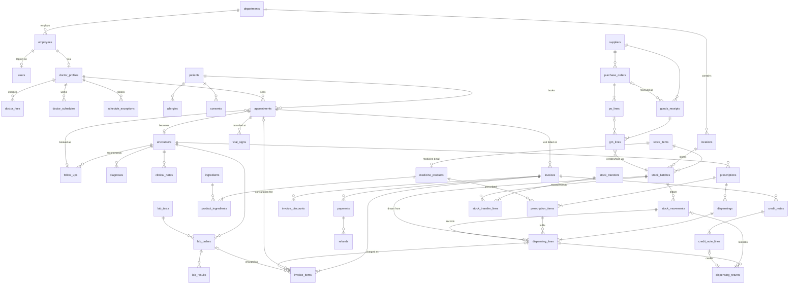

# HospitalOS: entity relationship design

Status: approved design, Day 2 (2026-10-14). The tables are implemented phase by phase, following [`roadmap.md`](roadmap.md).

Abbreviations: **PK** primary key, **FK** foreign key, **UQ** unique, **CK** check constraint, **IX** index.

## 1. Core diagram

## 2. Global rules

- Every FK uses `ON DELETE RESTRICT`. The only exceptions are `user_roles` and `role_permissions`, which use `CASCADE`.
- **Composite FKs keep patient-scoped child rows consistent.** Each parent table has `UQ (id, patient_id)`, and each child references `(parent_id, patient_id)`. This makes it impossible for a child row to belong to a different patient than its parent.
- Every mutable table has `created_at`, `updated_at`, `created_by` and `updated_by`.
- Status columns are Postgres enums, or text with a CHECK constraint. Allowed transitions are listed in [`state-machines.md`](state-machines.md).

## 3. Tables

### 3.1 Identity, organisation and access

| Table | Columns | Constraints and indexes |
|---|---|---|
| `hospital_settings` | see the defaults below this table | CK `id = 1` |
| `departments` | code, name, is_clinical, active | UQ code; UQ name |
| `locations` | department_id, code, name, kind (opd_room / pharmacy / store / lab) | UQ code. Seeded with `OPD-PHARM` and `GEN-STORE`. |
| `employees` | employee_no, names, department_id, designation, employment_status | UQ employee_no; IX department_id |
| `users` | employee_id, username (citext), password_hash, status, failed_logins, locked_until | UQ employee_id; UQ username |
| `roles` / `permissions` / `user_roles` / `role_permissions` | — | Join tables have composite PKs |
| `sessions` | sid, sess, expire | IX expire. The user is reloaded on every request, and any status other than `active` is rejected. |
| `audit_logs` | bigint id, occurred_at, actor_type (user / system), actor_user_id (null only when actor_type = system), action, entity_type, entity_id, patient_id, break_glass_grant_id, request_id, ip, changes (jsonb), reason | INSERT-only for `hms_app`. IX (entity_type, entity_id); IX (patient_id, occurred_at); IX (actor_user_id, occurred_at); IX (action, occurred_at) |
| `break_glass_grants` | user_id, patient_id, reason_category, reason_text, granted_at, expires_at, revoked_at, revoked_by, priority_review, reviewed_by, reviewed_at, review_outcome, review_note | CK `expires_at > granted_at`; CK `length(reason_text) >= 20`; CK `reviewed_by IS NULL OR reviewed_by <> user_id`; IX (user_id, patient_id, expires_at); partial IX WHERE `reviewed_at IS NULL` |
| `idempotency_keys` | user_id, key, endpoint, request_hash, response_status, response_body, created_at | PK (user_id, key) |

**Defaults in `hospital_settings`** (each can be changed without a code change):

| Setting | Default | Purpose |
|---|---|---|
| `name`, `timezone`, `currency` | — | Hospital identity; time zone `Asia/Kolkata` |
| `discount_limit_bp` | 1000 (10%) | Discount threshold before approval is needed |
| `near_expiry_days` | 30 | Window in which dispensing needs an acknowledgement |
| `care_window_before_days` | 7 | Days before a visit when the doctor can read the chart |
| `care_window_after_days` | 90 | Days after an encounter when the doctor can read the chart |
| `break_glass_hours` | 4 | How long an emergency grant lasts |
| `break_glass_alert_threshold` | 3 grants per user per 24 h | Flags grants for priority review; **never blocks access** |
| `follow_up_grace_days` | 7 | Days after `due_to` before a pending follow-up is marked missed |
| `prescription_validity_days` | 30 | Days after issue before an undispensed or partly dispensed prescription is closed |
| `day_close_time` | 23:30 | Local time when the end-of-day job runs (architecture section 7) |

`reason_category` is one of: emergency, covering_colleague, transferred_care, other.

The changes column in `audit_logs` stores field names only; it never stores sensitive values.

### 3.2 Doctors, fees and scheduling

| Table | Columns | Constraints and indexes |
|---|---|---|
| `doctor_profiles` | employee_id, department_id, specialty, registration_no, default_slot_minutes | UQ employee_id; UQ registration_no |
| `doctor_fees` | doctor_id, visit_kind (new / follow_up), fee_paise, effective_from, effective_to | CK `fee_paise >= 0`; **EXCLUDE** overlapping `daterange(effective_from, effective_to)` for the same (doctor_id, visit_kind) |
| `doctor_schedules` | doctor_id, weekday, start_time, end_time, slot_minutes, max_bookings, location_id, valid_from, valid_to | CK `start_time < end_time`; CK `slot_minutes BETWEEN 5 AND 120` |
| `schedule_exceptions` | doctor_id, starts_at, ends_at, kind (leave / blocked), reason | CK `starts_at < ends_at`; IX (doctor_id, starts_at) |
| `hospital_holidays` | date (PK), name | — |
| `appointments` | appointment_no, patient_id, doctor_id, department_id, kind (scheduled / walk_in / follow_up), status, visit_date, slot_start, slot_end, token_no, checked_in_at, consult_started_at, completed_at, cancel_reason, rescheduled_from_id, follow_up_id, version | See the list below |

Constraints on `appointments`:
- UQ appointment_no.
- **UQ (id, patient_id)** and **UQ (id, patient_id, doctor_id)**. These are the targets of the composite FKs.
- **EXCLUDE USING gist** `(doctor_id WITH =, tstzrange(slot_start, slot_end) WITH &&)` WHERE the status is active and `slot_start IS NOT NULL`.
- Partial UQ (patient_id, doctor_id, visit_date) for active statuses.
- UQ (doctor_id, visit_date, token_no).
- UQ rescheduled_from_id.
- **Partial UQ follow_up_id** for active statuses.
- Composite FK (follow_up_id, patient_id) → follow_ups.
- CK `slot_start < slot_end`.
- CK `kind = 'walk_in' OR slot_start IS NOT NULL`.
- IX (visit_date, doctor_id, status).

The active statuses are `booked`, `checked_in` and `in_consultation`.

**Fee resolution at check-in:**
1. Use the `doctor_fees` row for this doctor and visit type that is effective today.
2. If there isn't one, use the department's consultation price from `service_catalogue`.

Either way, the price is **copied** into the invoice line, so later fee changes don't alter it.

### 3.3 Patients

| Table | Columns | Constraints and indexes |
|---|---|---|
| `patients` | mrn, first_name, last_name, dob, sex, phone, email, address, blood_group, version | UQ mrn; IX phone; trigram IX on full name; IX dob |
| `patient_contacts`, `medical_history_entries`, `patient_medications` | patient_id, … | IX patient_id |
| `allergies` | patient_id, substance, ingredient_id, reaction, severity, status | IX patient_id; IX ingredient_id |
| `consents` | patient_id, purpose (reminders / marketing), granted, captured_by, captured_at, withdrawn_at | IX (patient_id, purpose) |
| `patient_documents` | patient_id, encounter_id, kind, storage_key, mime, size_bytes | Metadata only; files are kept in private storage |

### 3.4 Clinical

| Table | Columns | Constraints and indexes |
|---|---|---|
| `encounters` | encounter_no, appointment_id, patient_id, doctor_id, department_id, status, chief_complaint, started_at, completed_at | **UQ appointment_id**; UQ (id, patient_id); **composite FK (appointment_id, patient_id, doctor_id) → appointments(id, patient_id, doctor_id)**, so the encounter's doctor is always the appointment's doctor; IX (patient_id, started_at); IX (doctor_id, status) |
| `vital_signs` | appointment_id, patient_id, recorded_by, recorded_at, temp_c, pulse, bp_sys, bp_dia, resp_rate, spo2, weight_kg, height_cm, entered_in_error | **composite FK (appointment_id, patient_id) → appointments**; CK plausible ranges; IX appointment_id. See the note below this table. |
| `diagnoses` | encounter_id, description, code, code_system, is_primary | IX encounter_id. Editable only while the encounter is `in_progress` (trigger). Never deleted. |
| `clinical_notes` | encounter_id, kind (symptoms / observation / plan / addendum), body, author_id, amends_note_id | Editable only while the encounter is `in_progress`. Once it's completed, a trigger blocks UPDATE and corrections become addenda. Never deleted. |

**Vital signs belong to the visit, not the encounter.** A nurse can record them at triage, before the doctor starts the encounter, and the doctor can record more during the consultation. The encounter reaches them through its appointment, which is one-to-one. Vitals are never edited: a correction is a new reading, and the wrong one gets `entered_in_error = true`, the only column `hms_app` may update.
| `follow_ups` | patient_id, source_encounter_id, recommended_by, target_doctor_id, department_id, reason, instructions, due_from, due_to, status | UQ (id, patient_id); composite FK (source_encounter_id, patient_id) → encounters; CK `due_from <= due_to`; IX (status, due_to); IX (target_doctor_id, status) |

### 3.5 Prescriptions, medicines and stock

| Table | Columns | Constraints and indexes |
|---|---|---|
| `prescriptions` | rx_no, encounter_id, patient_id, doctor_id, status, issued_at, version | UQ (id, patient_id); composite FK (encounter_id, patient_id) → encounters; IX (status, issued_at) |
| `prescription_items` | prescription_id, medicine_product_id, dose, frequency, route, duration_days, qty_prescribed, qty_dispensed, substitution_allowed, allergy_ack_by | UQ (id, prescription_id); CK `qty_prescribed > 0`; **CK `qty_dispensed BETWEEN 0 AND qty_prescribed`** |
| `ingredients` | name (citext), synonyms | UQ name; trigram IX |
| `stock_items` | sku, kind (medicine / general), name, base_unit, category, reorder_level, tracks_expiry | UQ sku |
| `medicine_products` | stock_item_id (PK and FK), brand_name, manufacturer, dosage_form, route, pack_size, rx_only, equivalence_key | trigram IX brand_name; IX equivalence_key |
| `product_ingredients` | product_id, ingredient_id, strength_value (numeric), strength_unit | PK (product_id, ingredient_id); CK `strength_value > 0` |
| `stock_batches` | stock_item_id, location_id, batch_no, expiry_date, unit_cost_paise, sale_price_paise, qty_on_hand, status (active / quarantined / recalled) | **CK `qty_on_hand >= 0`**; UQ (stock_item_id, location_id, batch_no); **UQ (id, stock_item_id)**; IX (stock_item_id, location_id, expiry_date) |
| `stock_movements` | bigint id, batch_id, kind, qty (signed), balance_after, reason, ref_type, ref_id, performed_by, occurred_at | Append-only; CK `qty <> 0`; CK `balance_after >= 0`; IX (batch_id, occurred_at); IX (ref_type, ref_id) |
| `dispensings` | dispense_no, prescription_id, patient_id, location_id, idempotency_key, allergy_check_ack, dispensed_by, dispensed_at, status | UQ (id, prescription_id); composite FK (prescription_id, patient_id) → prescriptions; UQ idempotency_key |
| `dispensing_lines` | dispensing_id, prescription_id, prescription_item_id, batch_id, dispensed_product_id, qty, qty_returned, unit_price_paise, is_substitution, substitution_verified_by, substitution_note, near_expiry_ack, stock_movement_id | See the list below |
| `dispensing_returns` | return_no, dispensing_line_id, qty, reason, restocked, stock_movement_id, invoice_item_id, credit_note_line_id, returned_by, returned_at | See the list below |
| `stock_transfers` (Tier 2) | transfer_no, from_location_id, to_location_id, status (draft / dispatched / received / cancelled), created_by, received_by | CK `from_location_id <> to_location_id` |
| `stock_transfer_lines` (Tier 2) | transfer_id, from_batch_id, to_batch_id, qty, out_movement_id, in_movement_id | CK `qty > 0`; FK from_batch_id and to_batch_id → stock_batches; FK out_movement_id and in_movement_id → stock_movements (each UQ) |

**Equivalence key:** a trigger keeps `equivalence_key` in sync with `product_ingredients`. It is the sorted list of `ingredient:strength_value+unit`, then the dosage form, then the route, for example `paracetamol:500mg|tablet|oral`. It speeds up searching, but the dispensing service **recomputes** equivalence from the source rows and doesn't trust the stored key.

**Expiry date:** stored as the last day the batch is valid. A label reading "03/2027" is stored as 2027-03-31. The goods-receipt form enforces this.

**Movement kinds:** receipt, dispense, dispense_return, adjustment_in, adjustment_out, damage, expiry_writeoff, transfer_out, transfer_in, supplier_return.

**How a movement is linked to its source:** `stock_movements.ref_type` and `ref_id` are informational only. The authoritative link is a real FK from the source row to the movement:
- `dispensing_lines.stock_movement_id`
- `dispensing_returns.stock_movement_id`
- `grn_lines.stock_movement_id`
- `stock_transfer_lines.out_movement_id` and `in_movement_id`

Adjustments, damage and expiry write-offs need no separate source row: the movement itself, with its kind, reason and `performed_by`, is the record.

Constraints on `dispensing_lines`:
- **Composite FK (dispensing_id, prescription_id) → dispensings.**
- **Composite FK (prescription_item_id, prescription_id) → prescription_items.**
- **Composite FK (batch_id, dispensed_product_id) → stock_batches(id, stock_item_id).**
- CK `qty > 0`.
- CK `qty_returned BETWEEN 0 AND qty`.
- CK `NOT is_substitution OR substitution_verified_by IS NOT NULL`.
- **FK stock_movement_id → stock_movements(id)**, UQ.
- **FK dispensed_product_id → medicine_products(stock_item_id)**, so only medicines can be dispensed against a prescription.
- `qty_returned` equals the sum of this line's `dispensing_returns.qty`. It's maintained under a lock on the line and checked by a reconciliation test.

Constraints on `dispensing_returns`:
- FK dispensing_line_id → dispensing_lines.
- CK `qty > 0`.
- CK `restocked = (stock_movement_id IS NOT NULL)`.
- **CK `num_nonnulls(invoice_item_id, credit_note_line_id) = 1`.** A return either reduces a draft invoice line or is credited on an issued invoice.
- FK stock_movement_id → stock_movements, UQ.
- FK credit_note_line_id → credit_note_lines, UQ.
- FK invoice_item_id → invoice_items.

**Restock rule (default):** returned medicine goes back into the **original batch** (`dispense_return` movement) only when the pharmacist confirms it's unopened and the batch is still `active` and unexpired. Otherwise the return is recorded with `restocked = false`, for billing and audit, and no stock movement is written. The pack is disposed of outside the system.

### 3.6 Billing

| Table | Columns | Constraints and indexes |
|---|---|---|
| `service_catalogue` | code, name, department_id, kind (consultation / lab / procedure / other), price_paise, tax_rate_bp, active | UQ code; CK `price_paise >= 0` |
| `invoices` | invoice_no, patient_id, appointment_id (nullable), status, subtotal_paise, discount_paise, tax_paise, total_paise, credited_paise, paid_paise, refunded_paise, issued_at, void_reason, version | See the list below |
| `invoice_items` | invoice_id, service_id, description, source_type (consultation / dispensing / lab / manual), consultation_appointment_id, dispensing_line_id, lab_order_id, qty, unit_price_paise, discount_alloc_paise, tax_paise, line_total_paise, is_active | UQ (id, invoice_id); CK line arithmetic; **typed FKs** → appointments / dispensing_lines / lab_orders; CK typed FK matches `source_type`; **partial UQ on each typed FK column WHERE is_active** |
| `invoice_discounts` | invoice_id, invoice_item_id (nullable), base_amount_paise, percent_bp, amount_paise, threshold_bp_at_request, reason, requested_by, requested_at, status (applied / pending_approval / approved / rejected), approved_by, decided_at, decision_note | See the list below |
| `payments` | receipt_no, invoice_id, amount_paise, method (cash / card / upi / bank), reference, idempotency_key, status (completed / reversed), refunded_paise, received_by, reversed_by, reversal_reason | UQ (id, invoice_id); CK `amount_paise > 0`; **CK `refunded_paise BETWEEN 0 AND amount_paise`**; UQ idempotency_key; UQ receipt_no |
| `refunds` | refund_no, invoice_id, payment_id, amount_paise, reason, idempotency_key, requested_by, approved_by, status (requested / approved / rejected / paid) | composite FK (payment_id, invoice_id) → payments; CK `amount_paise > 0`; CK `approved_by <> requested_by`; UQ idempotency_key |
| `credit_notes` | credit_no, invoice_id, origin (manual / dispense_return / appointment_cancel / lab_cancel), reason, total_paise, created_by | UQ (id, invoice_id); CK `total_paise > 0` |
| `credit_note_lines` | credit_note_id, invoice_id, invoice_item_id, qty, amount_paise | composite FKs (credit_note_id, invoice_id) and (invoice_item_id, invoice_id). A return links to its credit-note line through `dispensing_returns.credit_note_line_id`. |
| `document_counters` | doc_type, fiscal_year, next_value | PK (doc_type, fiscal_year) |

Constraints on `invoices`:
- UQ invoice_no.
- UQ (id, patient_id).
- Composite FK (appointment_id, patient_id) → appointments.
- **Partial UQ (appointment_id) WHERE `status = 'draft'`**, so a visit has at most one draft invoice.
- CK `total = subtotal − discount + tax`.
- CK `credited BETWEEN 0 AND total`.
- CK `refunded BETWEEN 0 AND paid`.

The typed-FK rule on `invoice_items`:
- `source_type = 'consultation'` ⇔ only `consultation_appointment_id` is set.
- `'dispensing'` ⇔ only `dispensing_line_id` is set.
- `'lab'` ⇔ only `lab_order_id` is set.
- `'manual'` ⇔ none of the three is set.

The partial unique indexes mean each consultation, dispensing line or lab order can be on at most one active invoice line. That is what prevents double-charging.

Constraints on `invoice_discounts`:
- CK `amount_paise > 0`.
- CK `approved_by IS NULL OR approved_by <> requested_by`.
- CK `length(reason) >= 5`.
- Composite FK (invoice_item_id, invoice_id).
- `threshold_bp_at_request` records the threshold that applied at the moment of the request, so the audit trail stays meaningful after the setting changes.

**Deferred constraint triggers** run at commit time on `invoices` and check:
- `subtotal` equals the sum of active items' gross amounts.
- `discount` equals the sum of applied and approved discounts.
- `paid` equals the sum of completed payments.
- `refunded` equals the sum of paid refunds.
- `credited` equals the sum of credit notes.

**Derived values:**
- `amount_due = total − credited`
- `net_paid = paid − refunded`
- `balance = amount_due − net_paid`
- `refund_due = max(0, −balance)`
- The payment service rejects any payment larger than `balance`.

### 3.7 Laboratory (Tier 2)

| Table | Columns | Constraints and indexes |
|---|---|---|
| `lab_tests` | code, name, sample_type, service_id, turnaround_hours | UQ code |
| `lab_test_parameters` | test_id, name, unit, ref_low, ref_high, ref_text | UQ (test_id, name) |
| `lab_orders` | order_no, encounter_id, patient_id, test_id, ordered_by, priority, status, sample_barcode, collected_by, collected_at, verified_by, verified_at | composite FK (encounter_id, patient_id) → encounters; UQ sample_barcode; IX (status, created_at) |
| `lab_results` | order_id, parameter_id, value_num, value_text, unit, ref_low, ref_high (copied when entered), abnormal_flag, entered_by, is_current, superseded_by | partial UQ (order_id, parameter_id) WHERE is_current |

### 3.8 Procurement and Tier 3

**Procurement (Tier 2)**

| Table | Columns | Constraints and indexes |
|---|---|---|
| `suppliers` | code, name, gstin, phone, email, active | UQ code |
| `purchase_orders` | po_no, supplier_id, location_id, status (draft / submitted / partially_received / received / cancelled), created_by, approved_by | UQ po_no; FK supplier_id, location_id; **UQ (id, supplier_id)**; CK `approved_by IS NULL OR approved_by <> created_by` |
| `po_lines` | po_id, stock_item_id, qty_ordered, qty_received, unit_cost_paise | FK po_id, stock_item_id; **UQ (id, stock_item_id)**; CK `qty_ordered > 0`; CK `qty_received BETWEEN 0 AND qty_ordered` |
| `goods_receipts` | grn_no, supplier_id, po_id (nullable), location_id, supplier_invoice_ref, received_by, received_at | UQ grn_no; FK supplier_id, location_id; **composite FK (po_id, supplier_id) → purchase_orders(id, supplier_id)**, so a receipt matches its PO's supplier |
| `grn_lines` | grn_id, po_line_id (nullable), stock_item_id, batch_no, expiry_date, qty, unit_cost_paise, batch_id, stock_movement_id | FK grn_id; **composite FK (po_line_id, stock_item_id) → po_lines(id, stock_item_id)**; **composite FK (batch_id, stock_item_id) → stock_batches(id, stock_item_id)**; FK stock_movement_id → stock_movements (UQ); CK `qty > 0`. The service requires an expiry date when the item tracks expiry. |

**Other Tier 3 tables:**
- **HR:** `attendance`, `shift_assignments`, `leave_requests` (CK `start_date <= end_date`), `payroll_records`.
- **Finance:** `expense_categories`, `expenses` (CK `approved_by <> created_by`).
- **Equipment:** `equipment` (UQ asset_tag, UQ serial_no), `maintenance_schedules`, `maintenance_logs`.
- **Marketing:** `referral_sources`, `campaigns`, `enquiries` (with a nullable `converted_patient_id`), `enquiry_tasks`.

## 4. Transaction boundaries

| Operation | Inside one transaction | Locks taken |
|---|---|---|
| Book an appointment | Validate the slot, count capacity, insert, audit | `pg_advisory_xact_lock(doctor, date)`, plus the EXCLUDE constraint |
| Check in | Status, token, fee resolution, get or create the draft invoice, add the consultation line, recompute totals, audit | appointment → advisory lock (doctor, date) → invoice |
| Complete an encounter | Encounter status, appointment status, audit | encounter → appointment |
| **Dispense** | See section 5 | prescription → items → batches (by id) → invoice |
| Return a dispensed item | `dispensing_returns` row, `dispense_return` movement (only if restocked), `qty_returned`, reduce the draft line or create a credit note (`origin = dispense_return`), audit | dispensing line → batch → invoice |
| Cancel after check-in, or cancel a lab order | Status change, deactivate the draft line or create a credit note (`origin = appointment_cancel` / `lab_cancel`), audit | appointment or lab order → invoice |
| Stock adjustment | Movement with a reason, batch quantity, audit | batch |
| Stock transfer (Tier 2) | `transfer_out` movement, a `transfer_in` movement into a new or existing batch, audit | batches (by id) |
| Apply or approve a discount | Discount row, line allocation, recompute totals, audit | invoice |
| Record a payment | Idempotency row, payment, invoice amounts and status, receipt number, audit | invoice → counter |
| Approve a refund | Refund status, payment `refunded_paise`, invoice amounts, audit | invoice → payment |
| Goods receipt | GRN, batches, receipt movements, PO quantities, audit | PO → batches |
| Grant emergency access | Re-check password, insert the grant, compute the priority-review flag, audit | none (no cap is enforced) |
| End-of-day job | Each record's transition in its own small transaction, with a system-actor audit row | `pg_try_advisory_lock('day_close')` so only one instance runs; normal row locks per record |

**Global lock order:** appointment → prescription → prescription items → stock batches (ascending id) → invoice → payment → document counter.

READ COMMITTED isolation is enough here, because every rule that reads a value and then writes based on it holds an explicit row or advisory lock. The concurrency tests prove this (BK-2, DP-2, DP-4, DP-7).

## 5. The dispensing algorithm (server)

1. Look up the idempotency key. If it has been seen, return the stored response.
2. Check the `prescription:dispense` permission, plus `dispense:substitute` if any line substitutes a product.
3. Lock the prescription `FOR UPDATE`. Its status must be `issued` or `partially_dispensed`.
4. For each requested line:
   1. The requested quantity must be at most `qty_prescribed − qty_dispensed`. The item row is locked, so concurrent partial dispenses can't over-dispense.
   2. Lock the batch. Its status must be `active`, its location must be the pharmacy location, and `qty_on_hand ≥ qty`.
   3. **Expiry checks** (today in the hospital's time zone):
      - Reject if `expiry_date < today`.
      - If `duration_days` is known, reject if `expiry_date < today + duration_days − 1`. The check always uses the **full prescribed `duration_days`, counted from the dispensing date**, even for a partial dispense. This is the conservative default.
      - If `expiry_date ≤ today + near_expiry_days`, the request must include `near_expiry_ack`.
   4. **Substitution check**, when the batch's product differs from the prescribed product:
      - `substitution_allowed` must be true.
      - The server recomputes equivalence from `product_ingredients`, `dosage_form` and `route`.
      - The request must include `substitution_verified = true`.
5. Decrement the batch, insert a movement with `balance_after`, insert the dispensing line, and increase `qty_dispensed`.
6. Set the prescription status.
7. Get or create the visit's draft invoice. Add one line per dispensing line, then recompute totals.
8. Write the audit row and commit.

If any check fails, everything rolls back and the API returns 409 (a conflict, such as insufficient stock) or 422 (a rule violation), naming the line and the reason code. The database constraint `CK qty_on_hand >= 0` is the final safety net.

## 6. Integrity review checklist

- **Referential integrity:**
  - Composite FKs keep patient-scoped rows consistent, tie each encounter to its appointment's doctor, tie dispensing lines to the correct prescription and batch, and tie goods receipts to their PO's supplier and items.
  - Invoice lines point at what they charge for through typed FKs, not polymorphic ids.
  - Every stock movement is referenced by a real FK from its source row, and returns have their own table.
  - Vital signs attach to the visit, so they can be recorded before the encounter exists.
  - Follow-ups and appointments are linked in one direction only.
  - Every FK uses RESTRICT.
- **Concurrency:** the EXCLUDE constraint, advisory locks, `FOR UPDATE` row locks, the global lock order, idempotency keys and optimistic version checks.
- **Idempotency:** `idempotency_keys` is the replay mechanism, returning the stored response. The UQ `idempotency_key` columns on `dispensings`, `payments` and `refunds` are database backstops.
- **Totals:** CHECK constraints, deferred constraint triggers, and stock and invoice reconciliation queries run in the tests.
- **Auditability:**
  - Audit rows are written in the same transaction as the change.
  - Clinical reads fail closed if the audit write fails.
  - Notes, movements and the audit log are append-only.
  - The application's database role has no DELETE on clinical, financial or audit tables.
  - The discount trail includes the threshold that applied when each discount was requested.
