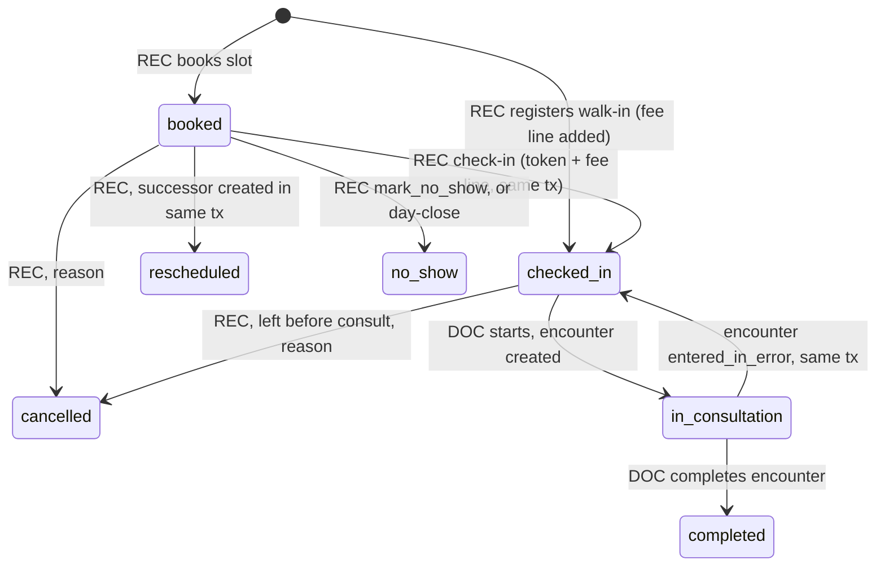
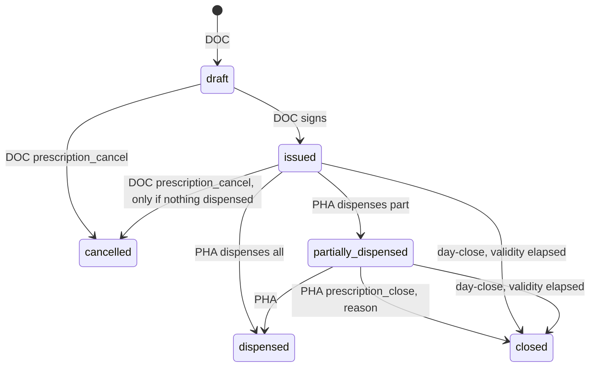
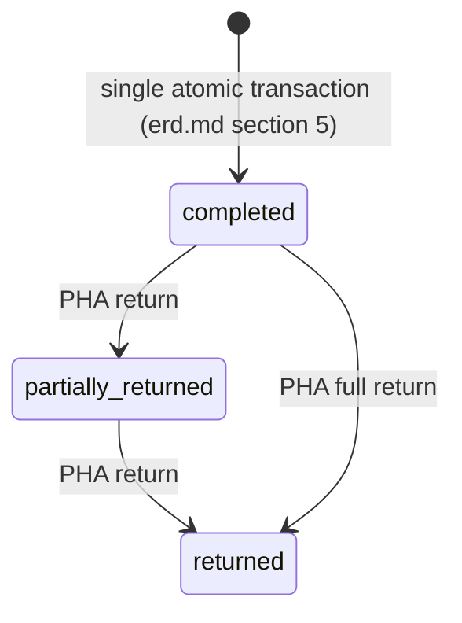
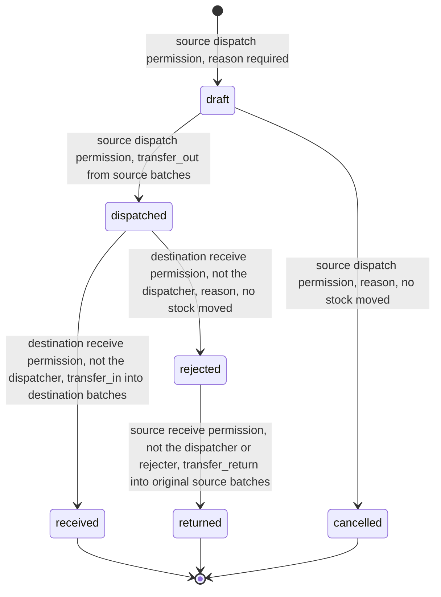
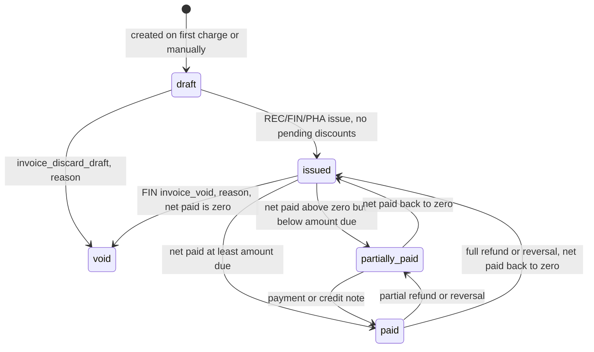
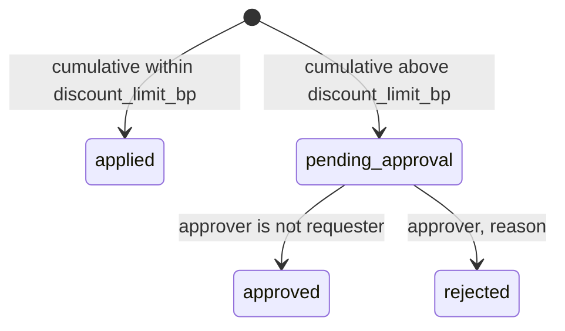
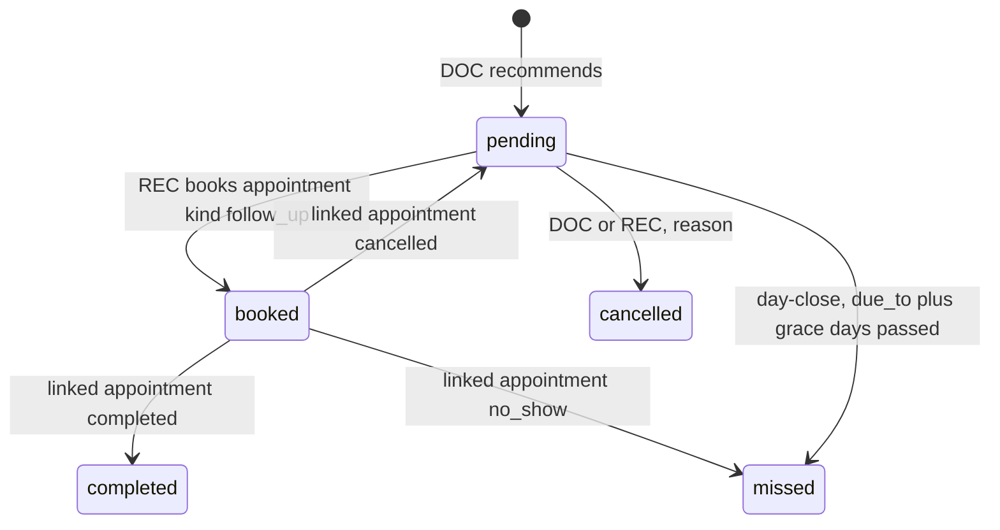
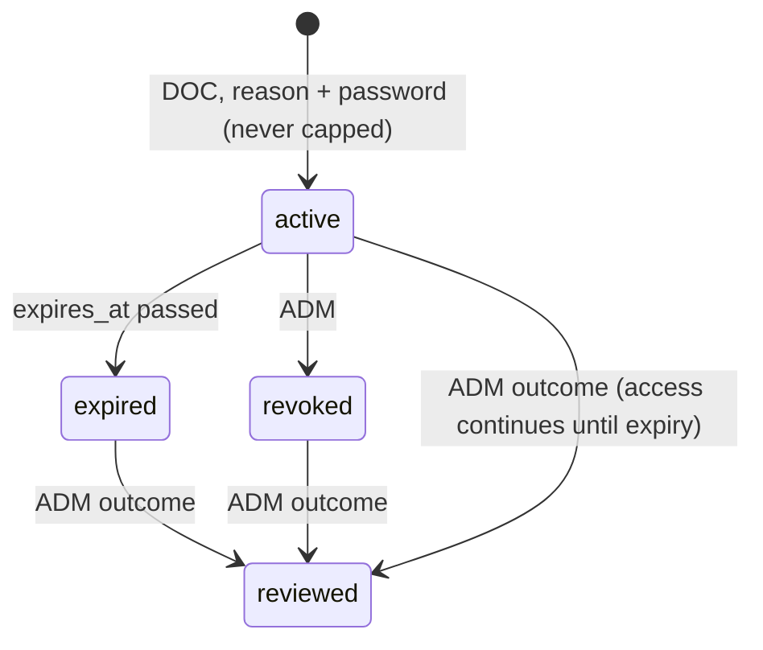
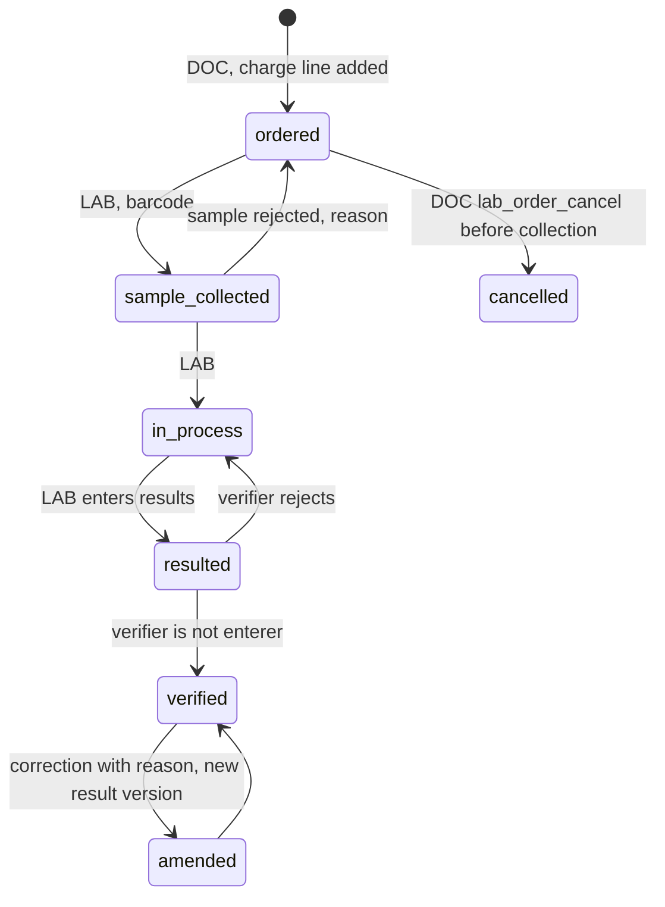

# HospitalOS: state machines

Status: approved design, Day 2 (2026-10-14).

Every transition is performed by a service method that checks the actor's permission and the record-level rules. Any transition not listed here is rejected with 409.

Transitions labelled **day-close** are run by the idempotent end-of-day job (architecture section 7). Its audit rows record `actor_type = system`. An administrator can also trigger the job manually with `day_close:run`.

Mermaid labels can't safely contain a second `:`, so the diagrams write permission codes with `_` in place of `:`. For example, `prescription_cancel` means `prescription:cancel`.

## 1. Appointment

- Only `booked`, `checked_in` and `in_consultation` occupy a slot in the EXCLUDE constraint.
- The day-close job marks `booked` appointments with `visit_date < today` as `no_show`. Appointments stuck in `checked_in` or `in_consultation` are **not** changed automatically. They're listed on the ADM and REC dashboards for someone to resolve.
- Vitals can be recorded once an appointment is `checked_in` (they belong to the visit; see the ERD).
- A cancellation after check-in also deals with the consultation fee:
  - If the fee is still on a draft invoice, that line is deactivated.
  - If the invoice has already been issued, the fee is reversed with a credit note.

## 2. Encounter

```mermaid
stateDiagram-v2
  [*] --> in_progress: DOC starts consultation
  in_progress --> completed: DOC completes; appointment completed in same tx
  in_progress --> entered_in_error: DOC, only if no prescriptions or lab orders
  completed --> completed: addendum note only
```

- **While `in_progress`:** the encounter's own notes and diagnoses can be edited, and each edit is audited with its changed field names. Nothing is ever deleted.
- **After `completed`:** a trigger blocks edits, and corrections are addenda.
- **`entered_in_error`:** moves the appointment back to `checked_in` in the same transaction, so the patient can be seen again.

## 3. Prescription

"Validity elapsed" means `issued_at + prescription_validity_days < today` (default 30 days).

An issued prescription can't be edited. To change it, cancel it (only possible if nothing has been dispensed) and issue a new one.

## 4. Dispensing

A dispensing has no pending state. Either every line passes the server checks and commits together, or nothing changes.

Each return is a `dispensing_returns` row, and the dispensing's status is derived from those rows. The original batch is restocked only under the ERD's restock rule. The billing effect depends on the invoice: on a draft invoice the line is reduced, and on an issued one a credit note is created with `origin = dispense_return`.

## 5. Stock transfer (Tier 2, modelled)

The permissions, by location kind:

| Step | Pharmacy | General store |
|---|---|---|
| Create, dispatch or cancel (source) | `stock_transfer:dispatch_pharmacy` (PHA) | `stock_transfer:dispatch_store` (INV) |
| Accept or reject (destination) | `stock_transfer:receive_pharmacy` (PHA) | `stock_transfer:receive_store` (INV) |
| Accept a returned transfer (source) | `stock_transfer:receive_pharmacy` (PHA) | `stock_transfer:receive_store` (INV) |

**Where the stock is in each state.** "In transit" is the line quantity of every `dispatched` or `rejected` transfer. It counts at neither location and is shown in its own in-transit report.

| State | Source batches | In transit | Destination batches |
|---|---|---|---|
| `draft` | unchanged | 0 | unchanged |
| `cancelled` | unchanged | 0 | unchanged |
| `dispatched` | reduced by the line qty (`transfer_out`) | line qty | unchanged |
| `received` | reduced | 0 | increased by the line qty (`transfer_in`) |
| `rejected` | reduced | line qty, on its way back | unchanged |
| `returned` | restored by the line qty (`transfer_return` into the **original** batch) | 0 | unchanged |

**Rules that keep stock from being created, lost or duplicated:**
- **Separate users.** The dispatcher never accepts, rejects or records the return of their own transfer. Acceptance and rejection at the destination are done by a different user from the dispatcher. The return receipt at the source is recorded by a different authorized user from **both** the dispatcher and the rejecter. The service returns 403 and the database CHECKs back it up.
- **History is kept.** Transfers and their lines are never deleted. Rejected, returned and cancelled transfers keep their full record: source, destination, batches, quantities, actors, times, rejection reason and final status.
- **Whole transfers only.** The destination accepts or rejects the whole transfer. A short or damaged delivery is rejected and returned, then re-sent as a new transfer.
- **Rejection moves no stock.** The goods stay in transit until the source accepts them back. A dispatched transfer can't be cancelled; it can only be accepted, or rejected and returned.
- **Returns go back to the original batch**, whatever that batch's status is now. If the batch was recalled or expired in transit, it keeps that status and isn't sellable; disposal is a separate, audited adjustment.
- **Acceptance re-checks the source batch.** If it's now recalled, quarantined or expired, acceptance returns 422 and the receiver rejects the transfer instead.
- **One transition at a time.** Each transition locks the transfer row, checks the expected status (409 otherwise), then locks the batches in ascending id order. A second acceptance, an acceptance racing a rejection, or a second return gets 409, and the unique movement FKs stop any line from moving twice.
- **Conservation.** Per line, the `transfer_out` quantity equals the `transfer_in` or `transfer_return` quantity, never both. The transfer reconciliation test checks this, along with DP-6 (ST-12).
- **Audit.** Dispatch, acceptance, rejection, return and cancellation each write their own audit row: `stock_transfer.dispatched`, `.received`, `.rejected`, `.returned` and `.cancelled`.
- **No single-step shortcut.** If time is short, transfers are deferred rather than simplified. **Every rule in this section, and ST-7 and ST-9 to ST-12, stays binding for whichever phase implements transfers.**

## 6. Invoice

- After any payment, refund, reversal or credit note, the status is **recalculated from the amounts**, never set by hand.
- An issued invoice can't be edited. Corrections are made with credit notes, or with a void followed by a reissue.
- **Who can create a credit note:**
  - A manual credit note needs `credit_note:create` (FIN).
  - A credit note created *inside* another workflow is authorized by that workflow's permission. That means `dispense:return` for returns, `appointment:cancel` for a cancellation after check-in, and `lab_order:cancel` for a lab cancellation.
  - The note's `origin` and the audit row record which workflow created it.

### 6.1 Invoice discount

- If a line is removed from a draft invoice so that its applied discounts now go over the threshold, those discounts return to `pending_approval`.
- An invoice with any discount in `pending_approval` can't be issued.

### 6.2 Payment and refund

- **Payment:** `completed`, then optionally `reversed` (by FIN, with a reason). A payment that has been partly refunded can't be reversed.
- **Refund:** `requested` → `approved` or `rejected`. An approved refund then moves to `paid`, and only then counts towards `refunded_paise`.

## 7. Follow-up

"Due" and "overdue" aren't stored. They are computed when read, from `due_from` and `due_to`.

## 8. Emergency access (break-glass) grant

`priority_review` is set when a grant is created and the user has gone over the 24-hour alert threshold. It changes the order of the review queue, never whether access is granted.

## 9. Lab order (Tier 2)

Cancelling a lab order also deals with its charge: if the line is on a draft invoice it's deactivated, and if the invoice is issued a credit note is created with `origin = lab_cancel`.
